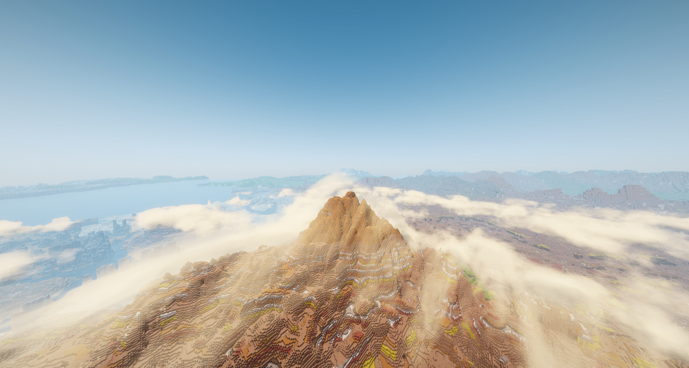
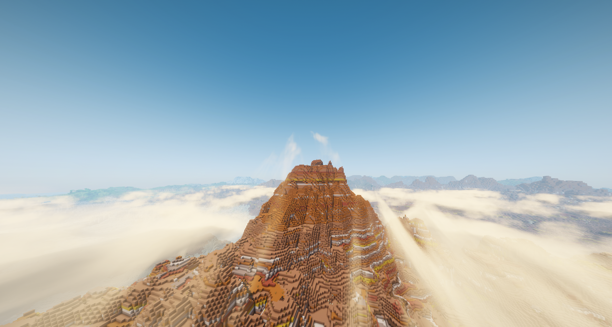
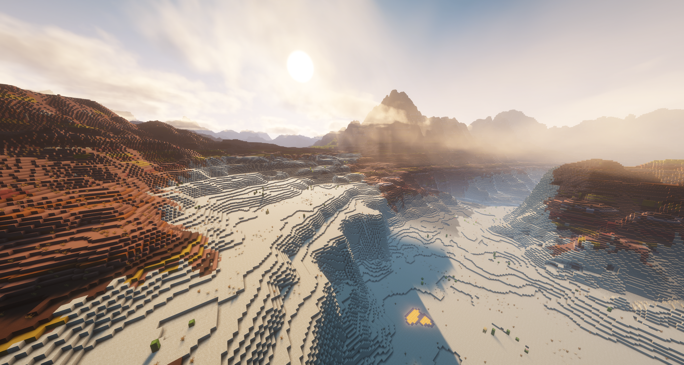
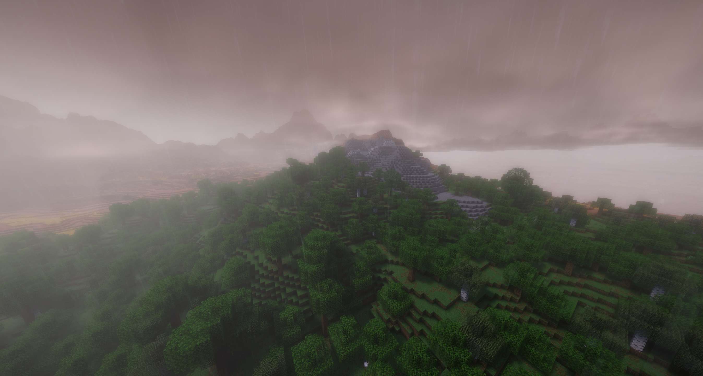
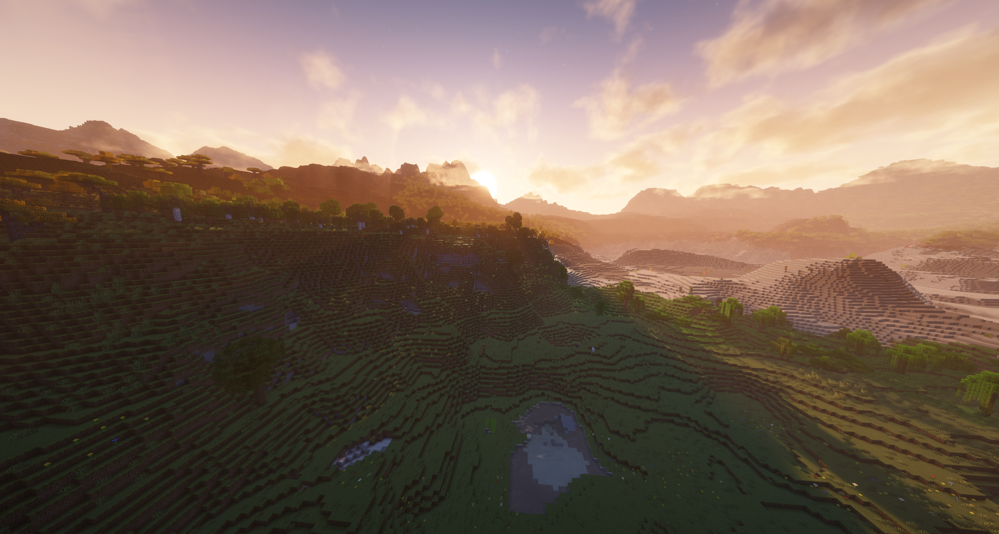
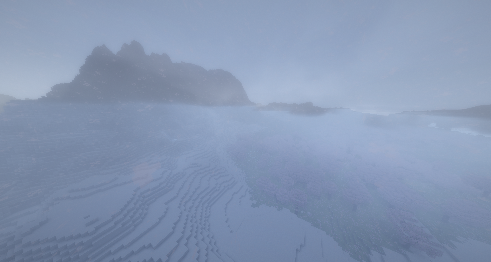
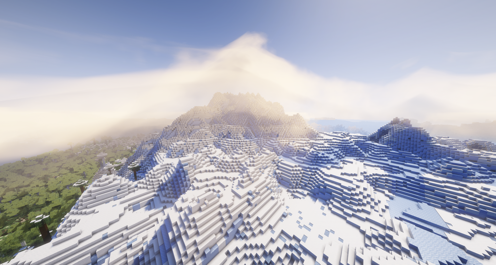
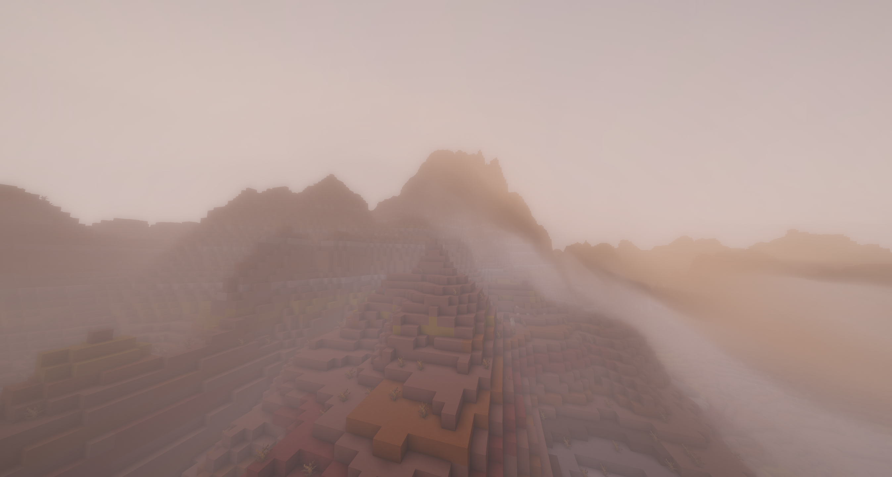

# Cinematic Drift

Cinematic Drift expands on Complementary with a more cinematic look, water shader fixes carried forward from the CinematicWater customizations, and terrain-responsive dynamic clouds that roll through valleys and spill over ridges.

This repository contains the **Ridge Clouds client mod**, standalone cloud lab, and a patcher that builds **Cinematic Drift** from a local CinematicWater installation.

Based on **Complementary Shaders by EminGT / Complementary Development**, preserving the existing CinematicWater customizations. Original downloads and attribution: [Complementary's official website](https://www.complementary.dev/). This is a customized derivative, not an official Complementary release.

## In-game gallery

Real captures from the running Minecraft 26.3 world in Dynamic cloud mode. [Capture details and viewpoints](docs/screenshots/README.md).





### Across weather and biomes

Sunrise over desert terrain.



Rain over forested hills.



Late afternoon light across plains.



Snowfall around mountain slopes.



Clear daylight in the frozen peaks.



Storm clouds around the original ridge.



## Requirements

Minecraft Java **26.3**, Java **25**, Fabric Loader **0.19.5**, Fabric API **0.162.0**, Iris **1.11.7**, and Sodium **0.9.2**. The patcher requires `ComplementaryUnbound_r5.9.3_CinematicWater.zip` in the profile's shaderpacks folder. Node.js runs the lab.

Generated shader ZIPs, vendor libraries, profile backups and installation records are excluded from Git. The patcher preserves the original shader license. The mod JAR contains only this project's classes and resources.

## Install and build

Copy `ridge-clouds-0.4.0+26.3.jar` into the Fabric profile's `mods` directory. Keep only one version of the mod installed. From the repository root in PowerShell:

```powershell
./mod/build-local.ps1 -InstanceDirectory '<your profile>' -JavaHome '<your JDK 25>'
./shader/patch-packs.ps1 -InstanceDirectory '<your profile>'
```

The build resolves dependencies from installed Minecraft libraries. Select the generated `patched-shaderpacks/CinematicDrift_DynamicClouds.zip` in Iris. The optional `install-curseforge.ps1` backs up changed files and installs the mod and generated shader. Close Minecraft before replacing a loaded mod JAR.

## Automatic mod releases

Every push to `main` builds the mod JAR from source with Java 25, runs the cloud simulation checks, and publishes a GitHub prerelease with the JAR and a SHA-256 checksum. Download builds from [Releases](https://github.com/joshkotrous/cinematic-drift/releases). The workflow can also be run manually from Actions. Build versions include the workflow run number and commit so each artifact can be identified.

The release contains the client mod. Generate the shader pack locally using the installation instructions above; the customized Complementary shader is not bundled in the mod JAR. CI downloads its pinned Minecraft, Fabric and Iris dependencies without needing a CurseForge installation. To run the same build locally with Python 3.11+ and JDK 25:

```sh
python mod/build-ci.py
```

## Cloud settings

Cloud Mode offers **Vanilla**, **Volumetric** (the original Complementary renderer), and **Dynamic** (terrain-responsive clouds). The Visual Style baseline is fixed; its selector and the Information tab are removed.

Under **Shader Options → Atmosphere → Clouds → Dynamic Clouds**:

- Density: **108%** default; **100%** preserves the original coverage baseline.
- Mountain wind gain: **1** default, giving up to **2×** base drift speed on high terrain. **0** disables the gain.
- Wind elevation range: **160 blocks above sea level** by default.

The mod samples loaded Overworld heightmaps, including Tectonic terrain. Wind changes affect both flow and visible cloud noise. Lee-side drying produces a finite spill. Distant Horizons' stored LOD terrain is not sampled by this build.

## Standalone lab

```sh
npm start
npm test
```

Open <http://127.0.0.1:8793>. Terrain, wind, altitude, density and evaporation are adjustable independently of Minecraft's shader settings.

## Source layout

- `engine/` and `preview/`: browser flow simulation and WebGL lab.
- `mod/src/main/java/dev/ridgeclouds/core/`: independent Java simulation.
- `mod/src/main/java/dev/ridgeclouds/client/`: world adapter, commands and safe GPU uploads.
- `mod/src/main/java/dev/ridgeclouds/mixin/`: version-specific Minecraft/Iris integration.
- `shader/`: dynamic renderer and pack transformation.
- `mod/src/test/java/` and `tests/`: GPU upload, shader routing, mountain wind and flow checks.

See [in-game testing skill](.cursor/skills/test-in-game/SKILL.md) for commands and [CRASH-FIX.md](CRASH-FIX.md) for the upload regression. This is an experimental build tied to the versions above. Appearance and performance need testing across locations and hardware.
